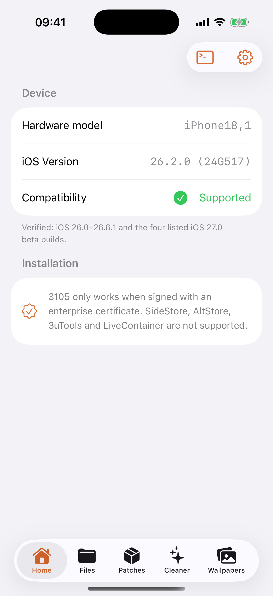
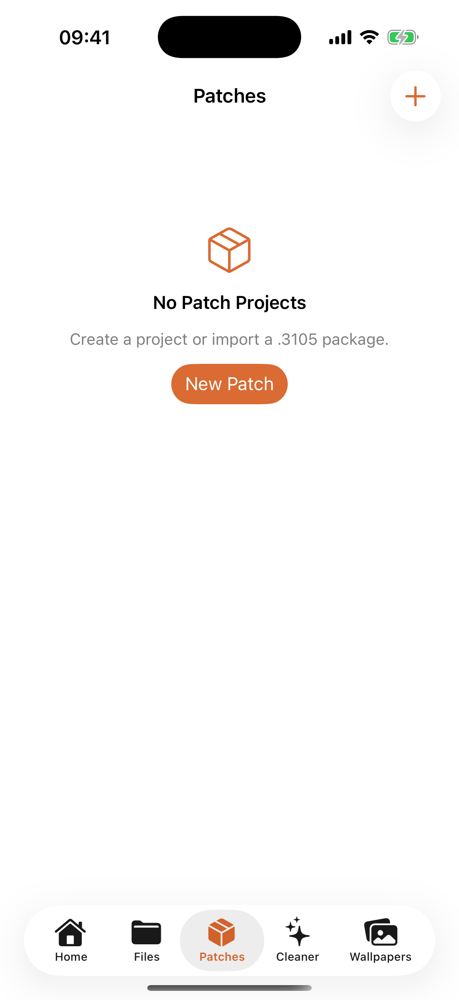
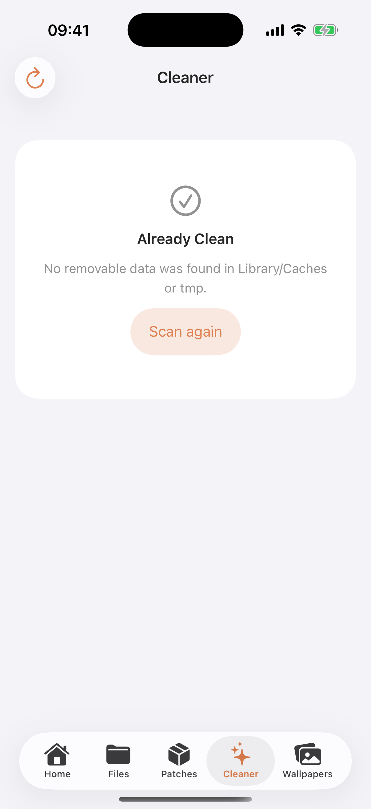

<p align="center">
  
</p>

<h1 align="center">Astra</h1>

<p align="center">
  A native iOS workspace for app-container files, portable patches, limited cleanup, and PosterBoard wallpaper packages.
</p>

<p align="center">
  
  
  
  
</p>

<p align="center">
  <a href="README.vi.md">Tiếng Việt</a> ·
  <a href="docs/PATCH_GUIDE.md">Patch guide</a> ·
  <a href="#compatibility">Compatibility</a> ·
  <a href="#license">License</a>
</p>

> [!WARNING]
> Astra is research software for personal device management. Keep a backup and use it only on devices and data you own. Simulator screenshots demonstrate UI only; they do not verify device-level access.

## Preview

<p align="center">
  
  &nbsp;
  
  &nbsp;
  
</p>

## What's new in 1.2.6

- **Astra branding** — app display name, product bundle, localizations, documentation, and CI artifact now use Astra.
- **Installed-game scanner** — only installed Free Fire variants are shown, using the icon resolved from the device with official bundled fallbacks.
- **Server-authoritative controls** — feature state is synchronized from the authenticated server session.
- **Direct support links** — Telegram community and developer actions open directly without Zalo dependencies.

## What's new in 1.1.0

- **Version-aware storage** — iOS 16.0–18.7.1 and iOS 26.0–26.6.1 use direct writes; iOS 18.7.2–18.8.x and iOS 26.6.2+ (including 26.7) use AirLift with a computer-generated pairing file; compatible iOS 27 builds can pair on-device or import a file.
- **Wrong-password feedback** — importing a `.3105` patch with an incorrect password now shows "Incorrect password" instead of failing silently.
- **Onboarding for reinstalls** — onboarding reappears after overwriting the app with the same version, so fresh and overwritten installs both see the guided setup.

See the complete [Patch workspace guide](docs/PATCH_GUIDE.md).

## What's new in 1.0.1

- **Patch workspace v2** — build patches as a normal bundle-based directory tree under `On My iPhone/3105/Patches`; Apply and Export synchronize the workspace automatically.
- **Safer recovery** — original files are journaled before writes; Restore puts existing files back, removes files introduced by the patch, and removes patch-created directories once empty.
- **More capable Files tab** — independent tabs, preserved folder position, multi-selection, ZIP creation and extraction, plus a denser and more consistent grouped layout.
- **Responsive navigation** — iPad split-view and landscape support, optional Cleaner/Wallpaper tabs, stable search fields, and refined icon/row sizing.
- **Wallpaper guidance** — corrected PosterBoard activation steps, including the iOS 27 Collections prerequisite.

See the complete [Patch workspace guide](docs/PATCH_GUIDE.md).

## Highlights

- **App Data Browser** — resolves volatile container UUIDs to stable app bundle identifiers and exposes a native file workspace.
- **File operations** — search, preview, share, import multiple files, copy, move, paste, rename, delete, create files and folders, make ZIP archives, and safely handle name conflicts.
- **Portable `.3105` patches** — bundle-based rules survive container-ID changes between devices; projects may include files or folders, support optional password protection, and can be imported from Files or a secure website link.
- **Limited Cleaner** — scans only each app's `Library/Caches` and `tmp`, sorts recoverable size in either direction, supports bulk selection, and requires confirmation before deletion.
- **Wallpaper Lab** — imports `.tendies` packages, validates payloads, journals installed items, and resets only content installed by Astra.
- **No persistent jailbreak installation** — Astra does not install a persistent jailbreak, bootstrap, or daemon. Because it uses device-level access and can modify app data, no universal guarantee can be made against every app's integrity policy.
- **Localized interface** — English, Vietnamese, and Simplified Chinese.

## Compatibility

3105 enables device-level features only for builds explicitly verified by the project:

| System | Verified range/builds |
| --- | --- |
| iOS 16 | 16.0 through 16.7.x (direct/kernel) |
| iOS 17 | 17.0 through 17.7.x (direct/kernel) |
| iOS 18 | 18.0–18.7.1 direct/kernel; 18.7.2–18.8.x AirLift + computer-generated pairing file |
| iOS 26 | 26.0–26.6.1 direct; 26.6.2 and newer, including 26.7, use AirLift + computer-generated pairing file |
| iOS 27.0–27.1 | AirLift + on-device Developer Mode pairing or imported pairing file |
| iOS 27.2 beta 1 | `24B5084k` — AirLift + on-device or imported pairing |
| iOS 27.2 beta 2 | `24B5089g` — AirLift + on-device or imported pairing |

iOS 27.2 beta 3 (`24B5099f`) and newer are marked unsupported because the AirTraffic path is patched. Unlisted iOS 27.2 builds fail closed rather than being assumed compatible.

## Installation notes

- Device functionality requires signing with an **enterprise certificate**.
- SideStore, AltStore, 3uTools, and LiveContainer are not supported installation paths.
- The target bundle identifier is intentionally `com.apple.mobile.MobileHouseArrest`; changing it can break the MHA-C2 app-container workflow.
- The source tree does not contain certificates, provisioning profiles, signed applications, or IPA files; release assets may provide an unsigned IPA.

## Project layout

```text
3105/
├── ThreeOneOSFive/          # SwiftUI app, helpers, native bridges, localizations
├── ThreeOneOSFive.xcodeproj # Xcode project and 3105 scheme
└── docs/images/             # Repository artwork and current UI previews
```

## Security and responsible use

Do not publish logs, app containers, cookies, account databases, or patch payloads containing personal data. Report security-sensitive issues privately to the maintainer.

## Credits

Astra is maintained by Minh Khải and Sơn Dev. The original 3105 project was developed and designed by [YangJiii](https://x.com/duongduong0908).

Special thanks to [0xjohnny](https://x.com/0xjohnny) for [FilzaSlop](https://github.com/0xjohnnydev/FilzaSlop) and related research:

- [MobileHouseArrest-PoC](https://github.com/0xjohnnydev/MobileHouseArrest-PoC) — ContainerManager identity-trust bug
- [Geod-MCM-PoC](https://github.com/0xjohnnydev/Geod-MCM-PoC) — `geod` MobileContainerManager `partDomain` traversal
- [InstallCoordination-PoC](https://github.com/0xjohnnydev/InstallCoordination-PoC) — persisted-state and final-symlink chain
- [CFPrefsZeroFile-PoC](https://github.com/0xjohnnydev/CFPrefsZeroFile-PoC) — `cfprefsd` zero-file creation

The project also builds on work from Pocket Poster/Nugget, CrazyMind90, forcequitOS, Dopamine, and their contributors. See [THIRD_PARTY_NOTICES.md](THIRD_PARTY_NOTICES.md) for full attribution and upstream links.

## License

Original portions of Astra/3105 are distributed under the [GNU General Public License v3.0](LICENSE). Third-party components remain subject to their respective upstream copyright and license terms; see [THIRD_PARTY_NOTICES.md](THIRD_PARTY_NOTICES.md).
